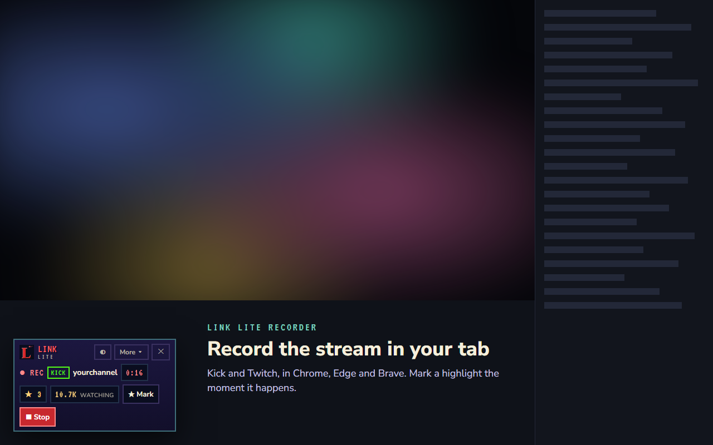
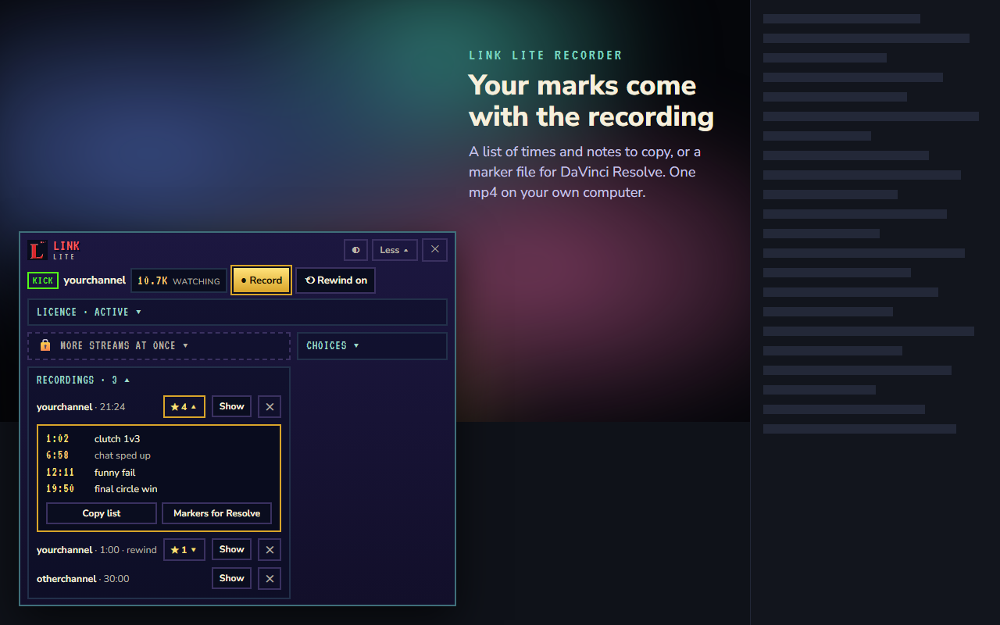
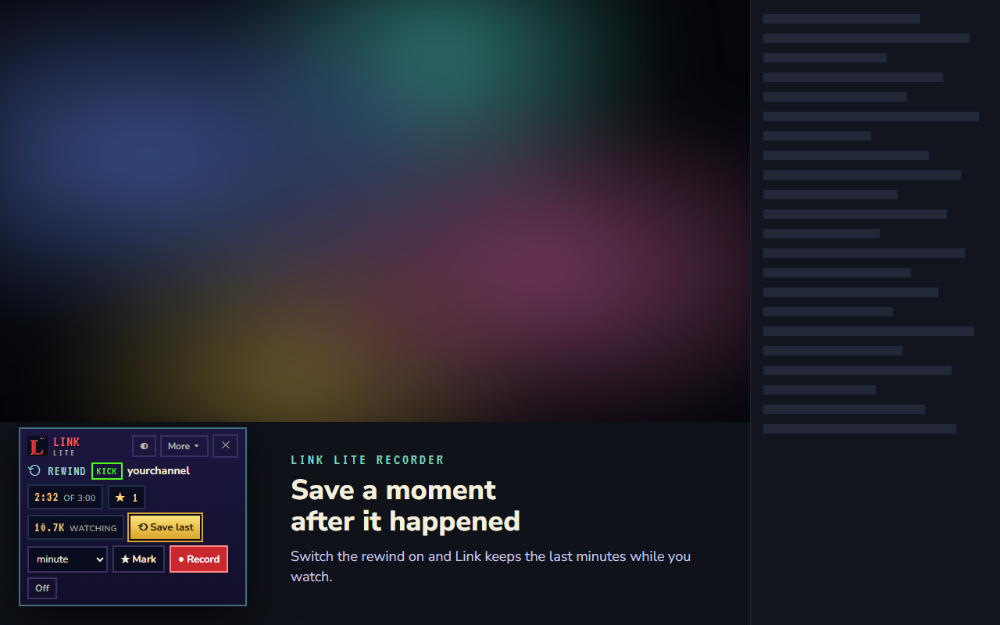

# Link

**From a live stream to a clip, on your own computer.** Free and open source.

[**Website**](https://linkturbo.app) &nbsp;·&nbsp; [**The code**](https://github.com/shushu-eco/link) &nbsp;·&nbsp; [**Add to Chrome**](https://chromewebstore.google.com/detail/link-lite-recorder/jjbnifoddmcjocjdmiaondcimkjmkjaa) &nbsp;·&nbsp; [**Discord**](https://discord.gg/N3jdn6WPJd) &nbsp;·&nbsp; [**How it works**](https://linkturbo.app/how-it-works)

 

## This repository

It holds the published pages of [linkturbo.app](https://linkturbo.app), served by GitHub Pages, and
nothing else.

**Link's code is in [shushu-eco/link](https://github.com/shushu-eco/link)**: the browser extension
(Link Lite Recorder), the Windows program (Link TURBO, with Link Night), and the source these pages
are built from. Problems and ideas go there, or to Discord.

## Link Lite Recorder

A browser extension for **Chrome, Edge and Brave**. It records the Kick or Twitch stream playing in your tab, lets you mark the highlights as they happen, and saves one mp4 to your own computer. It is free and open source: no licence key, no account, no limit on recordings.

| | |
|---|---|
| **● Record** | Picture and sound, cut out of the page. One mp4, up to 30 minutes. |
| **★ Mark** | A hotkey and a few words ("clutch 1v3"). Or by itself, when chat speeds up. |
| **⟲ Rewind** | Switched on, it keeps the last 3 minutes, so a moment can be saved after it happened. |
| **▣ For your editor** | The marks come with the recording: a list to copy, or a marker file for DaVinci Resolve. |
| **⌂ Stays on your computer** | Nothing is uploaded. No account, no analytics. Chat is only counted: never who wrote, or what. |

<table>
<tr>
<td></td>
<td></td>
</tr>
</table>

## Link TURBO

The full program for Windows: record up to 3 streams at once, have the moments found for you, edit finished 9:16 clips, post them, and see how they did. **Link Night** records streams while you are away and has the moments ranked when you are back. Free and open source as well. Download it for Windows as [Link-Setup.exe](https://github.com/shushu-eco/link/releases/download/installer/Link-Setup.exe) or [Link-Windows.zip](https://github.com/shushu-eco/link/releases/download/installer/Link-Windows.zip); it keeps itself up to date.

## Links

| | |
|---|---|
| Website | [linkturbo.app](https://linkturbo.app) |
| The code | [github.com/shushu-eco/link](https://github.com/shushu-eco/link) |
| Chrome Web Store | [Link Lite Recorder](https://chromewebstore.google.com/detail/link-lite-recorder/jjbnifoddmcjocjdmiaondcimkjmkjaa) |
| Discord | [discord.gg/N3jdn6WPJd](https://discord.gg/N3jdn6WPJd) |
| The guide | [linkturbo.app/how-it-works](https://linkturbo.app/how-it-works) |
| Open source | [linkturbo.app/open-source](https://linkturbo.app/open-source) |
| What's new | [linkturbo.app/changelog](https://linkturbo.app/changelog) |
| Support | [support@linkturbo.app](mailto:support@linkturbo.app) |
| Privacy · Terms · Copyright | [privacy](https://linkturbo.app/privacy) · [terms](https://linkturbo.app/terms) · [copyright](https://linkturbo.app/copyright) |

Licence: [GNU General Public License, version 3](LICENSE).

Link is a tool. Record your own streams, or streams whose owner allows it. Not affiliated with Kick or Twitch.
